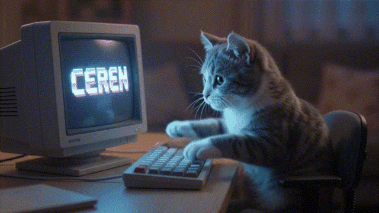

  <!-- Daktilo / Oyun Efektli Başlık -->
  

    

  <!-- Piksel Kedi GIF -->
  

    

  <!-- Rozetler -->
  
  

 

<picture>
  <source media="(prefers-color-scheme: dark)" srcset="https://raw.githubusercontent.com/cerendogrul120-byte/cerendogrul120-byte/output/github-contribution-grid-snake-dark.svg" />
  <source media="(prefers-color-scheme: light)" srcset="https://raw.githubusercontent.com/cerendogrul120-byte/cerendogrul120-byte/output/github-contribution-grid-snake.svg" />
  
</picture>
